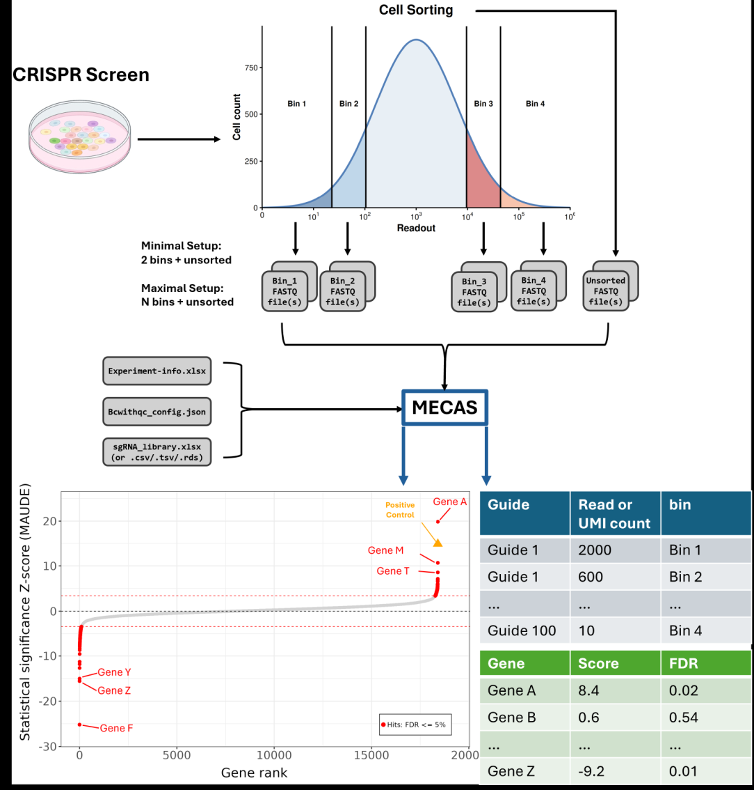

# MECAS: Multi-bin Error-Corrected Analysis of Screens

MECAS is a [Snakemake](https://snakemake.readthedocs.io/en/stable/)-based pipeline designed to analyse pooled CRISPR screens of bin-sorted samples.

It processes FASTQ sequencing files and calculates read/UMI counts and
guide-level and gene-level statistics for overall enrichment trends across bins.
MECAS uses [bcwithqc](https://github.com/hawkjo/bcwithqc) for the error-corrected detection of guide sequences and unique molecular identifiers (UMIs),
and [MAUDE](https://github.com/de-Boer-Lab/MAUDE) for guide-level and gene-level statistical analyses.



## Installation

MECAS runs on Linux and requires:

* Python 3.11 or newer
* Apptainer
* Internet access during installation and the initial container download

Install MECAS and its Python dependencies directly from GitHub using:

```bash
python -m pip install "git+https://github.com/LukasLink/mecas.git"
```

Confirm that the installation was successful:

```bash
mecas version
mecas --help
```

Skip to the end for additional/optional installation tips.


## Usage

Display the general command overview with `mecas --help` and the options for each command with
`mecas COMMAND --help` (example: `mecas all --help`).

### Quick start

MECAS includes a small example dataset that can be used for a ~10-minute test run.

Copy the example files into a directory of your choice:

```bash
mecas examples --output-dir /path/to/your/directory
```

This creates the `/path/to/your/directory/mecas_examples` directory, with templates and example data inside.

Run the complete pipeline on the example dataset:

```bash
mecas all \
    --input-dir /path/to/your/directory/mecas_examples/input_dir \
    --output-dir /path/to/your/directory/mecas_examples/test_run \
    --library-file /path/to/your/directory/mecas_examples/example_library.xlsx \
    --bcwithqc-config-file /path/to/your/directory/mecas_examples/example_bcwithqc_config.json \
    --experiment-info-file /path/to/your/directory/mecas_examples/experiment_info_file_template.xlsx \
    --reads-or-umis reads \
    --profile local
```

After the run completes, inspect the following result files:

```text
/path/to/your/directory/mecas_examples/test_run/results/MAUDE_Hits.xlsx
/path/to/your/directory/mecas_examples/test_run/plots/03_waterfall_plots/waterfall_controls_top3_FDR0.05.png
```

EGFP should be the only significant result in the example analysis.

IMPORTANT NOTE: 
Since this pipeline is snakemake based, you need to inspect the snakemake logs for info, warning, and error
messages. You can find them in output-directory/logs/[profile]_logs.

### Commands

| Command               | Description                                                                                                                  |
| --------------------- | ---------------------------------------------------------------------------------------------------------------------------- |
| `all`                 | Run the complete pipeline.                                                                                                   |
| `setup`               | Resolve the configuration and create the FASTQ manifest.                                                                     |
| `QC_filter`           | Run FASTQ quality-control filtering.                                                                                         |
| `bcwithqc_preprocess` | Prepare input files for bcwithqc.                                                                                            |
| `bcwithqc_count`      | Run bcwithqc counting.                                                                                                       |
| `reads_per_umi_count` | Read the BAM files generated by bcwithqc and create one RDS count file for each paired or unpaired input file.               |
| `count`               | Create downstream count tables. If you only need the read/umi counts you can stop here.                                      |
| `MAUDE`               | Run the MAUDE analysis. Generates guide & gene level statistics.                                                             |
| `plot`                | Generate plots and summaries. This command can be run after `mecas MAUDE` or `mecas count`.                                  |
| `cleanup`             | Remove intermediate results and large BAM files. Only use this command after confirming that the final results are complete. |
| `examples`            | Copy the MECAS example files into the requested output directory.                                                            |
| `version`             | Print the installed MECAS version and exit.                                                                                  |

### Pipeline options

The available options depend on the selected command. Run `mecas COMMAND --help` to display the exact options for a particular pipeline stage.
Any unknown arguments are passed through to Snakemake, preserving access to its full command-line functionality.

#### Input and output

`-h`, `--help`
Display the help message and exit.

`--input-dir INPUT_DIR`
Directory containing the input FASTQ files.

`--output-dir OUTPUT_DIR`
Master output directory for the analysis.

`--library-file LIBRARY_FILE`
Library annotation file containing the guide sequences. See the library construction section below, and the `example_library.xlsx` produced by `mecas examples`.

`--bcwithqc-config-file BCWITHQC_CONFIG_FILE`
bcwithqc JSON configuration file specifying the locations of guide and UMI sequences within the FASTQ reads.
See the corresponding section below and the [bcwithqc documentation](https://github.com/hawkjo/bcwithqc).

`--experiment-info-file EXPERIMENT_INFO_FILE`
Experiment information spreadsheet containing information about the FASTQ files and bins. See the corresponding section below or the `Explanation` sheet in the `experiment_info_file_template.xlsx` produced by `mecas examples`.

#### Counting and analysis

`--reads-or-umis {reads,umis}`
Use read counts or deduplicated UMI counts. The default is `reads`.

`--umis-as-sublibs`
Treat each sgRNA–UMI combination as a replicate guide by assigning each its own sublibrary (this will massively increase the runtime).

`--separate-statistics-by {none,sample,sublib,bin-group}`
Calculate statistics separately according to the selected grouping dimension. The default is `none`.

`--separate-statistics-for-gene-level-by {none,sample,sublib,all}`
Calculate gene-level statistics separately according to the selected grouping dimension after guide-level statistics have already been calculated. The default is `none`.

`--sum-sgrna-counts-for-guide-level-by {none,sample,sublib}`
Before calculating guide-level statistics, sum counts for the same sgRNA across the selected dimension while keeping the other dimensions separate. The default is `none`.

`--run-consensus-call`
Run the MAUDE analysis 20 times and perform consensus calling to minimise random sampling effects. This option is disabled by default.

`--skip-qc-filtering`
Skip cutadapt quality-control filtering and pass the input FASTQ files directly to downstream processing. Quality-control filtering is enabled by default.

#### Execution profiles

`--profile {local,cluster-generic,slurm,htcondor,lsf,sge}`
Select the local or cluster environment in which the Snakemake pipeline will run. The default is `local`.

`--custom-profile CUSTOM_PROFILE`
Use a custom Snakemake profile. When supplied, this option overrides the built-in profile selected with `--profile`.

#### Cluster configuration

`--account ACCOUNT`
Specify the cluster account used for job submission.

`--partition PARTITION`
Specify the cluster partition or queue.

`--qos QOS`
Specify the cluster quality-of-service setting.

`--reservation RESERVATION`
Submit jobs using the specified cluster reservation.

#### Resource overrides

`--threads THREADS`
Override the number of threads requested for resource-intensive jobs, including `QC_filter`, `bcwithqc_preprocess`, and `bcwithqc_count`.

`--memory-mb MEMORY_MB`
Override the memory requested for resource-intensive jobs, in megabytes.

`--runtime-minutes RUNTIME_MINUTES`
Override the runtime requested for resource-intensive jobs, in minutes.

#### Advanced Options
After `mecas setup` has completed, a config file will be created in
`your_path/output_dir/pipeline/config.yaml`. This file gives access to several
advanced options like fine grained adjustments to generated plots, Read filtering
parameters, and excluding n% of non-targeting control guides from the process
to retain them for inspection. 

## Required input files

The pipeline requires the following user-provided files:

- FASTQ files, compressed or uncompressed. Single-end and paired-end reads can be mixed in the same run if they are specified correctly in the experiment information file.
- An `experiment-info.xlsx` file that associates each FASTQ file with a bin, read direction, sublibrary, and sample, and describes the bins.
- A `bcwithqc-config.json` file that specifies the read structure and where guide sequences and optional UMIs are located. See [Building the bcwithqc config file](#building-the-bcwithqc-config-file).
- A library file (`.csv`, `.tsv`, `.xlsx`, or `.rds`) containing the guide sequences. See [Library construction](#library-construction).

### Experiment information file

The `experiment-info.xlsx` file has two sheets: `fastq_names` and `bins`.
The `experiment_info_file_template.xlsx` created by `mecas examples` provides a starting point.

#### `fastq_names` sheet

Add one row for each FASTQ file. For paired-end data, list the R1 and R2 files on separate rows.
For single-end data, leave `read` blank.

| `original_file` | `bin_name` | `sublibrary` | `sample` | `read` |
| --- | --- | --- | --- | --- |
| `my_unsorted_bin_R1.fastq.gz` | `input` | `L1` | `sampleA` | `R1` |
| `my_unsorted_bin_R2.fastq.gz` | `input` | `L1` | `sampleA` | `R2` |
| `my_top_10_bin.fastq.gz` | `top_10` | `L1` | `sampleA` | |
| `my_bot_10_bin.fastq.gz` | `bottom_10` | `L1` | `sampleA` | |
| `my_top_20_bin.fastq.gz` | `top_20` | `L1` | `sampleA` | |
| `my_bot_20_bin.fastq.gz` | `bottom_20` | `L1` | `sampleA` | |

Use the exact FASTQ filenames in `original_file`.
The `bin_name`, `sublibrary`, and `sample` values associate each file with its bin, sublibrary, and sample.

#### `bins` sheet

Add one row for each bin used in the experiment.

| `bin_name` | `sorted_or_unsorted` | `bin_fraction_min` | `bin_fraction_max` |
| --- | --- | ---: | ---: |
| `input` | `unsorted` | | |
| `bottom_10` | `sorted` | 0 | 0.1 |
| `bottom_20` | `sorted` | 0.1 | 0.2 |
| `top_10` | `sorted` | 0.9 | 1 |
| `top_20` | `sorted` | 0.9 | 0.8 |

The bin names in this sheet must match the `bin_name` values in the `fastq_names` sheet. Unsorted bins do not need fraction boundaries; sorted bins use `bin_fraction_min` and `bin_fraction_max` to describe their fraction boundaries.

### Library construction

The library file defines the sgRNA or barcode library used by the pipeline. An example library file, `example_library.xlsx`, is provided by `mecas examples`.

#### Summary

The library file must contain columns corresponding to these canonical names:

```text
sgrna_id
sgrna_seq
entrez_id
gene_symbol
control
```

Alternative column names are accepted as described below.

#### Supported file formats

MECAS supports the following library file formats:

* TSV (`.tsv`)
* CSV (`.csv`)
* Excel (`.xlsx`)
* R data serialization (`.rds`)

For an RDS file, the stored object must be a data frame.

#### Required columns

##### 1. sgRNA identifier

Canonical column name:

```text
sgrna_id
```

Accepted alternative:

```text
sgrna
```

Requirements:

* Missing values are not allowed.
* Values should be unique.
* If duplicate values are present, MECAS makes them unique by adding numeric suffixes and logs a warning.

For example:

```text
sgRNA_A
sgRNA_A
sgRNA_A
```

becomes:

```text
sgRNA_A
sgRNA_A_2
sgRNA_A_3
```

This column contains the identifier for each sgRNA or barcode entry.

##### 2. sgRNA sequence

Canonical column name:

```text
sgrna_seq
```

Accepted alternatives:

```text
seq
sgrna_sequence
sequence
```

Requirements:

* Missing values are not allowed.
* Values must be nucleotide sequences.
* Only `A`, `C`, `G`, `T`, and `N` are allowed.
* Sequences are converted to uppercase during processing.

This column contains the nucleotide sequence of each sgRNA or barcode.

##### 3. Entrez gene ID

Canonical column name:

```text
entrez_id
```

Accepted alternative:

```text
entrez
```

Requirements:

* Missing values are allowed.
* Non-missing values must be integers or strings containing only digits.

Valid examples:

```text
7157
"7157"
```

Invalid examples:

```text
TP53
ENSG00000141510
7157.5
```

This column contains the Entrez gene identifier, where available.

##### 4. Gene symbol

Canonical column name:

```text
gene_symbol
```

Accepted alternatives:

```text
gene
symbol
```

Requirements:

* Missing values are allowed.
* Non-missing values should be strings.

This column contains the gene symbol or target name.

##### 5. Control or type annotation

Canonical column name:

```text
control
```

Accepted alternative:

```text
type
```

Requirements:

* Missing values are not allowed.
* Each value must be one of the following:

```text
targeting
non_targeting_control
targeting_control
```

This column defines whether each sgRNA targets a gene or belongs to one of the control categories.

#### Optional columns

##### 6. Sublibrary

The sublibrary column is required when sgRNAs must be matched to specific sublibraries. It is optional otherwise.

Canonical column name:

```text
sublib
```

Accepted alternative:

```text
sublibrary
```

Requirements:

* Missing values are allowed.
* Non-missing values should be strings matching the sublibrary names used in the experiment information file.
* If the column is absent, MECAS assigns every row to sublibrary `L1`.
* Missing values within an existing sublibrary column are also replaced with `L1`.

This column identifies the sublibrary to which each sgRNA belongs.

##### 7. Count

Canonical column name:

```text
count
```

Requirements:

* If the column is present, missing values are not allowed.
* Values must be integers or strings containing only digits.

Valid examples:

```text
1
10
"25"
```

If the column is absent, MECAS assigns a count of `1` to every row.

This column can be used to specify the reference copy number of an entry in the library.

### Column-name normalization

Column names are matched case-insensitively. Spaces and periods are converted to underscores before matching.

For example, all of the following names are normalized before matching:

```text
sgRNA ID
sgrna.id
sgrna_id
```

#### Additional processing

* Sequence values are converted to uppercase.
* Missing sublibrary values are replaced with `L1`.
* If the `count` column is absent, all rows receive a count of `1`.
* Missing values are not allowed when the `count` column is present.
* Duplicate sgRNA identifiers are made unique by adding numeric suffixes, and MECAS logs a warning.


### bcwithqc config file construction

The bcwithqc config is a JSON file that describes where barcode and UMI sequences occur in each read.
Start with the example file created by `mecas examples`,
then edit its read structures and block sequences to match your library and FASTQ reads.
Save the result as `.json` or `.json.gz`.

The top-level options apply to the whole file:

| Option | Meaning |
| --- | --- |
| `unknown_read_orientation` | Set to `true` if paired reads may have been swapped between R1 and R2 and must be identified. Otherwise, set to `false`. |
| `single_end_reads` | Set to `true` for single-end reads or `false` for paired-end reads. Paired-end configs need both `barcode_struct_r1` and `barcode_struct_r2`. |

`barcode_struct_r1`, and `barcode_struct_r2` then declare the structure of the
two read directions. For single end reads you do not need `barcode_struct_r2`,
and if there are only barcodes on one direction of read-pair you do not need to
include the structure of the read without barcodes. 
Each read structure contains `keep_nonbarcode` and an ordered list of `blocks`.
The top-level `keep_nonbarcode` controls whether any undeclared sequence after the final block is kept.
Blocks describe the read from left to right: they must be contiguous,
start at the left end of the read, and may be followed by an undeclared overhang.

Each block needs these fields:

| Field | Meaning |
| --- | --- |
| `blockname` | A name for the block. |
| `blockfunction` | `barcode` or `UMI`, describing the block’s role. |
| `blocktype` | `barcodeList`, `constantRegion`, or `randomBarcode`. |
| `sequence` | A list of sequences for `barcodeList` or `constantRegion`. A constant region has one sequence; a barcode list can have several. |
| `length` | The length of a `randomBarcode` block. |
| `maxerrors` | Maximum errors allowed when matching the block. |
| `keepblock` | Whether to keep the block for alignment. If `false` this block will not appear in the ouput FASTQ or BAM file. |

Use `sequence` for fixed sequences and `length` for random sequences. For example,
a barcode list contains the possible barcode sequences, while a random barcode block can describe a UMI by its length.

This paired-end example has a barcode, a constant region, and a six-base UMI in each read:

```json
{
    "unknown_read_orientation": false,
    "single_end_reads": false,
    "barcode_struct_r1": {
        "keep_nonbarcode": false,
        "blocks": [
            {
                "maxerrors": 1,
                "blockfunction": "barcode",
                "sequence": [
                    "CCTTAACAT",
                    "AGCGTAGAA",
                    "TATAGGTGT",
                    "GGCGACTCA"
                ],
                "blocktype": "barcodeList",
                "blockname": "bc_r1",
                "keepblock": false
            },
            {
                "maxerrors": 1,
                "blockfunction": "barcode",             
                "sequence": [
                    "GGGTCAGTACGTACGAGTCCC"
                ],
                "blocktype": "constantRegion",
                "blockname": "con_r1",
                "keepblock": true
            },
            {
                "maxerrors": 0,
                "blockfunction": "UMI",
                "length": 6,
                "blocktype": "randomBarcode",
                "blockname": "umi_r1",
                "keepblock": false
            }
        ]
    },
    "barcode_struct_r2": {
        "keep_nonbarcode": true,
        "blocks":[            
            {
                "maxerrors": 1,
                "blockfunction": "barcode",
                "sequence": [
                    "CCTTAACAT",
                    "AGCGTAGAA",
                    "TATAGGTGT",
                    "GGCGACTCA"
                ],
                "blocktype": "barcodeList",
                "blockname": "bc_r2",
                "keepblock": false
            },
            {
                "maxerrors": 1,
                "blockfunction": "barcode",             
                "sequence": [
                    "GGGTCAGTACGTACGAGTCCC"
                ],
                "blocktype": "constantRegion",
                "blockname": "con_r2",
                "keepblock": false
            },
            {
                "maxerrors": 0,
                "blockfunction": "UMI",
                "length": 6,
                "blocktype": "randomBarcode",
                "blockname": "umi_r2",
                "keepblock": false
            }
        ]
    }   
}
```

The R1 and R2 structures can differ;
set each read’s block order, sequences, error allowance,
and keep options to match the actual reads.
Ensure the file is valid JSON: use double quotes around keys and string values,
and do not leave a trailing comma after the last item.

Constant regions can also contain a list of different sequences, if there 
may be multiple different possible constant regions. This can also be used
to desribe a possible stagger in your reads. Simply remove the first base from
your constant region (because sequences can not be empty strings) and then
describe the stagger as below.
```json
"blocks": [
  {
    "maxerrors": 1,
    "blockfunction": "discard",
    "sequence": [
      "T",
      "AT",
      "GAT",
      "CGAT"
    ],
    "blocktype": "constantRegion",
    "blockname": "stagger",
    "keepblock": false
  }
```
| Sequence | Meaning |
| --- | --- |
| `T` | A stagger of 0, T is the first base of the constant sequence. |
| `AT` | A stagger of 1: `A` |
| `GAT` | A stagger of 2: `GA` |
| `CGAT` | A stagger of 3: `CGA` |

For additional details, see the [bcwithqc documentation](https://github.com/hawkjo/bcwithqc).


## Tips
### Installation Tips
#### Installation on a cluster

When installing MECAS on a computing cluster, ensure that the Python environment containing MECAS is stored on a filesystem accessible from both the login and compute nodes.

For example:

```bash
module load Python/3.13.5-GCCcore-14.3.0

python -m venv /path/on/shared/filesystem/.venvs/mecas
source /path/on/shared/filesystem/.venvs/mecas/bin/activate

python -m pip install "git+https://github.com/LukasLink/mecas.git"
```

Before using MECAS in a new shell session, load the required Python module and activate the environment again:

```bash
module load Python
source /path/on/shared/filesystem/.venvs/mecas/bin/activate
```

#### Apptainer container

During the first pipeline run, MECAS downloads the following Apptainer container:

```text
oras://ghcr.io/lukaslink/mecas-container:0.5.0
```

By default, the container is cached under:

```text
~/.cache/mecas/apptainer
```

On a computing cluster, this location must be accessible from the compute nodes. You can specify a different location by setting `MECAS_APPTAINER_PREFIX` before running MECAS:

```bash
export MECAS_APPTAINER_PREFIX=/path/on/shared/filesystem/mecas/apptainer
mecas [COMMAND] [OPTIONS]
```

The container is reused in subsequent runs and does not need to be downloaded again unless the cache is removed or a different container version is requested.

### Usage Tips
The config.yaml generated in /output-dir/pipeline during `mecas setup` contains advanced options, that can be edited. 

The snakemake command `--force` can be added given as an option to avoid having to delete output files to get snakemake to re-run a task during a re-run. 
If you would rather delete output files instead a quick way to do this is enter the hidden directory output-directory/.pipeline_state and delete the .done files for all stages that you wish to re-run.

Since mecas may run for quite a while on larger datasets it is recommended to use a detachable screen session. to run the process.
This allows MECAS to continue running if you disconnect from the server or close your terminal.

```bash
screen -S mecas_project
mecas [COMMAND] [OPTIONS]
```
Detach from the screen without stopping MECAS by pressing: Ctrl+A, then D
Then reconnect later with:
```bash
screen -r mecas_project
```
If the connection was interrupted without properly detaching the screen, it may still be marked as attached. It can be detached and reconnected with:
```bash
screen -d -r mecas_project
```

